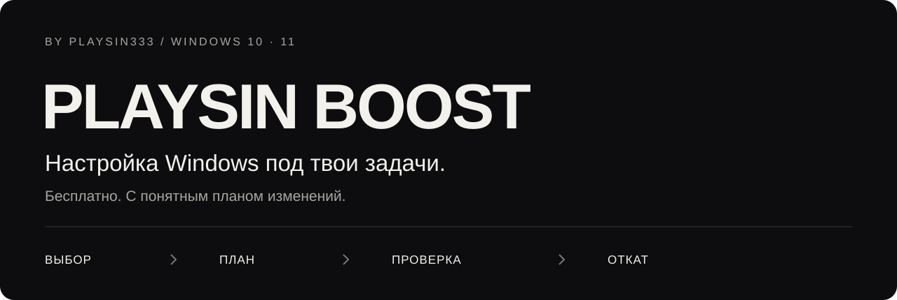
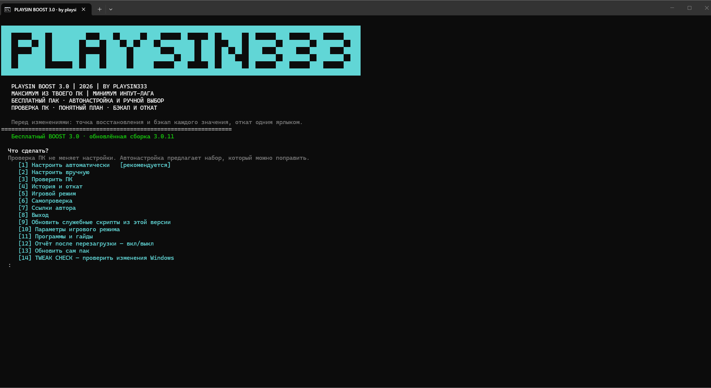
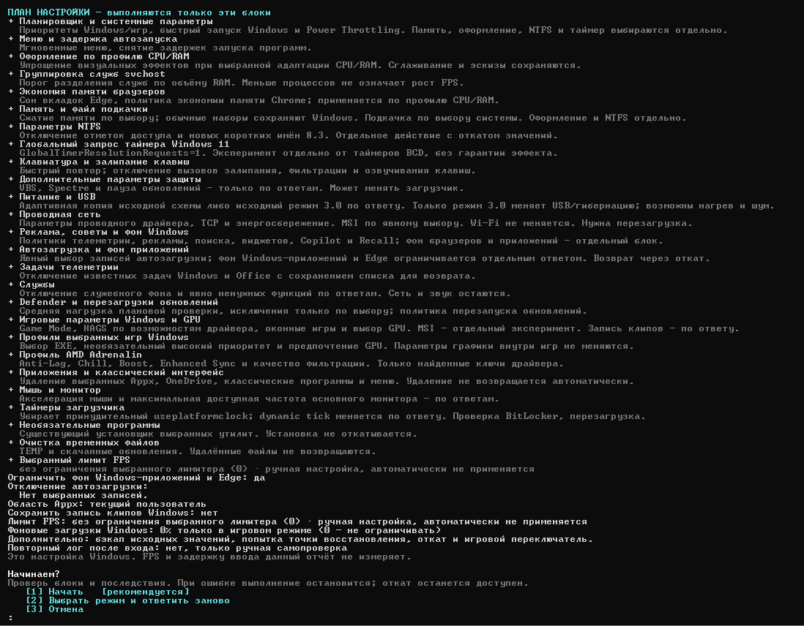
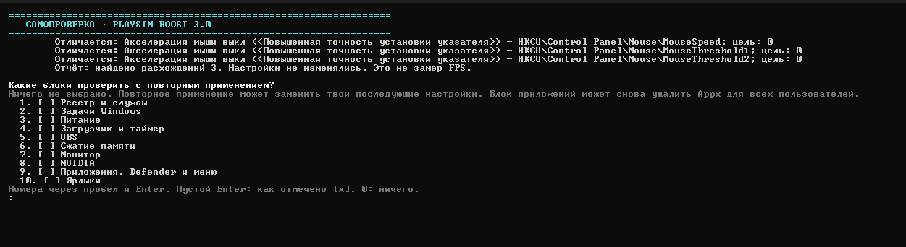

  

<b>Бесплатная настройка Windows 10 / 11 x64 от playsin333.</b> Готовые наборы, ручной выбор и понятный план до применения.

  

  <a href="https://github.com/playsin333/playsin-boost/blob/main/docs/CHANGELOG.md">Что нового</a> ·
  <a href="https://github.com/playsin333/playsin-boost/blob/main/docs/QUICKSTART.md">Как запустить</a> ·
  <a href="https://discord.gg/brMD3VYUAu">Помощь в Discord</a> ·
  <a href="https://t.me/playsin333tgk">Telegram</a>

 3.0.16 · preview · исходники доступны · без обязательной оплаты

---

## Настройка под твои задачи

PLAYSIN BOOST объединяет настройку фона Windows, автозагрузки, питания и игровых параметров. Выбирай готовый набор или отдельные блоки вручную. До запуска программа показывает, что собирается изменить, и спрашивает подтверждение.

| Выбери | Посмотри план | Проверь результат |
| :--- | :--- | :--- |
| Начни с проверки ПК, затем выбери нужные блоки | Проверь ответы и состав действий до применения | Прочитай лог, запусти самопроверку; при необходимости используй предусмотренный откат |

## Что внутри

| Возможность | Для чего |
| :--- | :--- |
| **Проверка ПК** | Сведения о системе без применения настройки |
| **Готовые наборы и ручной выбор** | Состав можно изменить перед подтверждением |
| **Фоновая работа Windows** | Автозагрузка, службы, задачи и оформление — по выбранному плану |
| **Игровые параметры** | Поддерживаемый HAGS, предпочтение GPU для выбранных EXE и доступный способ ограничения FPS |
| **Игровой режим** | Отдельная схема питания и выбранные действия с фоновыми программами |
| **Сохранение и откат** | Исходные значения отслеживаемых настроек, история и возврат через меню или ярлык |
| **Самопроверка и TWEAK CHECK** | Отчёты о настройках BOOST и изменениях Windows |
| **12 гайдов к утилитам** | Локальные инструкции и официальные ссылки, без автоматической установки |

[Все возможности и ограничения →](https://github.com/playsin333/playsin-boost/blob/main/docs/FEATURES.md)

## Интерфейс

Настоящее меню из обзора, сборка **3.0.11**. Текущая версия сохраняет этот принцип работы; номер сборки и ссылки обновлены.

<b>Посмотреть план перед применением и самопроверку</b>

План показывает выбранные блоки. Пример с расширенным выбором не является рекомендацией включать всё.

Самопроверка сообщает о расхождениях. На этом примере их три; это не замер FPS и не подтверждение применения всех настроек.

## Начать

1. [Скачай ZIP 3.0.16](https://github.com/playsin333/playsin-boost/raw/refs/heads/main/releases/v3.0.16/PLAYSIN-BOOST-3.0.16.zip) и **распакуй весь комплект** в обычную папку.
2. Запусти `PLAYSIN BOOST 3.0.bat`. Папки `nvidia`, `checker` и `Программы` оставь рядом. Используется штатный Windows PowerShell — отдельно устанавливать его не нужно.
3. Открой **3 — Проверить ПК**, затем выбери набор или ручной выбор. Прочитай план и подтверди нужные действия. Для применения потребуется повышение прав своей учётной записи Windows.
4. Прочитай итоговый лог и выполни перезагрузку, если она нужна выбранным настройкам.

[Подробная инструкция](https://github.com/playsin333/playsin-boost/blob/main/docs/QUICKSTART.md) · [Частые вопросы](https://github.com/playsin333/playsin-boost/blob/main/docs/FAQ.md) · [Переход со старой версии](https://github.com/playsin333/playsin-boost/blob/main/docs/QUICKSTART.md#переход-со-старой-версии)

Если вместо русского текста видны `???`, смотри [инструкцию](docs/FAQ.md#вместо-русского-текста-вопросительные-знаки).

## Что важно перед настройкой

**BOOST меняет настройки Windows.** Открытые исходники позволяют изучить реализацию, но сами по себе не гарантируют безопасность и совместимость с любым ПК. Прирост FPS и снижение задержки не гарантируются. Самопроверка сравнивает настройки, а не измеряет производительность.

Исходные значения отслеживаемых параметров сохраняются в `C:\PLAYSIN333` на системном диске. Не удаляй эту папку, пока нужен откат. **Удалённые приложения и очищенные файлы автоматически не возвращаются; установка дополнительных программ общим откатом не отменяется.** Сохраняй важные данные отдельно.

Отключение антивируса не является обязательным условием запуска. При блокировке сначала выясни конкретное обнаружение и проверь источник файла. Дополнительные изменения параметров защиты имеют последствия и выбираются отдельно.

Это **preview-сборка**. Автоматические проверки используют временные файлы и имитацию системных команд; они не заменяют проверку драйверов, UAC и отката на конкретном компьютере.

[Подробнее о безопасности и откате →](https://github.com/playsin333/playsin-boost/blob/main/docs/SAFETY.md)

## Программы и гайды

Пункт **11** открывает инструкции. Устанавливать весь список не нужно — выбирай под задачу.

| Задача | Инструменты |
| :--- | :--- |
| Датчики и сведения о железе | HWiNFO, CPU-Z, GPU-Z |
| Состояние накопителей | CrystalDiskInfo |
| Автозагрузка и процессы | Autoruns, Process Explorer |
| FPS, время кадра и мониторинг | CapFrameX, MSI Afterburner / RTSS |
| Проверка стабильности | OCCT |
| Профили и отдельные эксперименты | NVIDIA Profile Inspector, Process Lasso, ISLC |

[Каталог гайдов →](https://github.com/playsin333/playsin-boost/tree/main/Программы) У сторонних программ свои лицензии и условия.

## Обновления

**13 — обновить сам комплект:** проверка версии, подтверждение, скачивание и проверка ZIP, установка рядом с сохранением прежней папки и резервных данных.

**9 — обновить служебные скрипты:** обновление из уже распакованной версии без повторного применения настройки. Первый переход со старого приватного репозитория нужно выполнить вручную; произвольные пользовательские источники обновлений сохраняются.

[История изменений](https://github.com/playsin333/playsin-boost/blob/main/docs/CHANGELOG.md) · [Как устроен канал обновлений](https://github.com/playsin333/playsin-boost/blob/main/docs/UPDATE-CHANNEL.md)

## Помощь и новости

| Ссылка | Что там |
| :--- | :--- |
| [Discord-сервер](https://discord.gg/brMD3VYUAu) | Сообщество проекта |
| [Форум помощи](https://discord.com/channels/1563168877326893066/1567498318202929253) | Запуск и настройки |
| [Форум багов](https://discord.com/channels/1563168877326893066/1567498320622911529) | Ошибки и воспроизведение |
| [GitHub Issues](https://github.com/playsin333/playsin-boost/issues/new/choose) | Баги и предложения |
| [Telegram — @playsin333tgk](https://t.me/playsin333tgk) | Обновления и инструкции |
| [YouTube — @plays1n](https://www.youtube.com/@plays1n) | Обзоры автора |

В обращении укажи версию BOOST, сборку Windows, действия и нужный фрагмент лога **без личных данных**. [Сообщить об уязвимости приватно](https://github.com/playsin333/playsin-boost/blob/main/SECURITY.md).

Индивидуальная настройка ПК под твои задачи — отдельная услуга, по цене договоримся. Сам PLAYSIN BOOST бесплатный и не требует покупки настройки.

<b>Видео, разработка и лицензии</b>

[Полный обзор, вертикальные ролики, превью и описания](https://github.com/playsin333/playsin-boost/blob/main/media/README.md) хранятся отдельно и не входят в обновления программы. Обзор записан до переноса и содержит старый адрес `pc-optimizer`; актуальный адрес проекта — этот репозиторий.

Главный исходник — гибридный BAT/PowerShell `PLAYSIN BOOST 3.0.bat`. [Как участвовать](https://github.com/playsin333/playsin-boost/blob/main/CONTRIBUTING.md) · [Что проверено](https://github.com/playsin333/playsin-boost/blob/main/docs/VALIDATION.md) · [Сторонние компоненты](https://github.com/playsin333/playsin-boost/blob/main/THIRD-PARTY-NOTICES.md).

Общая лицензия авторского кода пока не выбрана. Публичная доступность исходников сама по себе не определяет условия повторного использования; лицензии сторонних компонентов сохранены.

