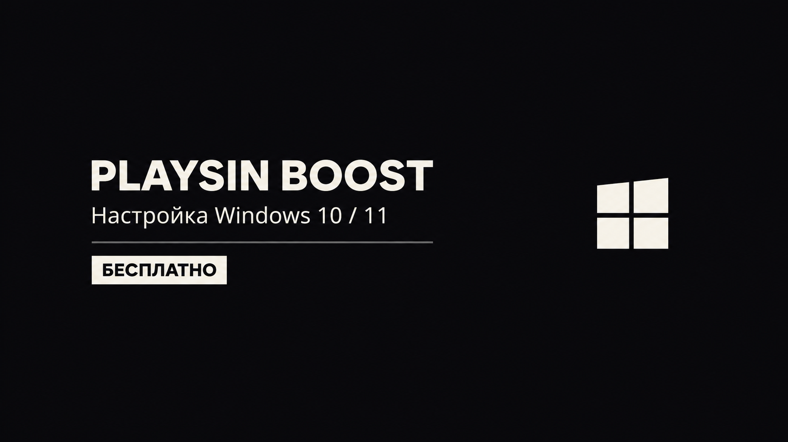
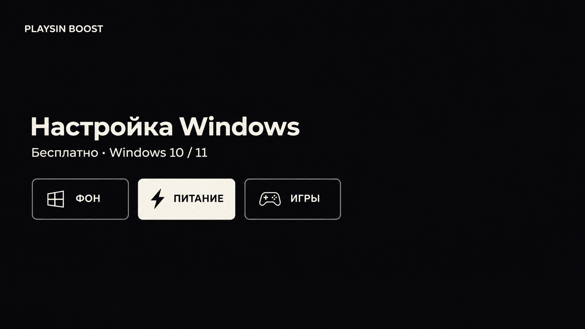

# Видео и материалы PLAYSIN BOOST

Готовые экспорты без перемонтажа. Видео не входят в пользовательский ZIP и обновления программы.

| Файл | Содержание |
| --- | --- |
| [Полный обзор v9](videos/PLAYSIN-BOOST-overview-v9.mp4) | 10:47,03 · 1920×1080 · 60 fps |
| [Коротко о BOOST v2](videos/PLAYSIN-BOOST-intro-vertical-v2.mp4) | 30,35 с · 1080×1920 · 60 fps · TikTok / Shorts |
| [Безопасность v1](videos/PLAYSIN-BOOST-safety-vertical-v1.mp4) | 40,92 с · 1080×1920 · 60 fps |

Для скачивания открой файл и выбери Download raw file.

## Превью

Два простых варианта, созданных с помощью генерации изображений. Это иллюстрации для публикации, а не скриншоты программы.

| Название и Windows | Карточки |
| --- | --- |
|  |  |

## Тексты

[YouTube](descriptions/youtube.txt) · [Shorts](descriptions/shorts.txt) · [TikTok](descriptions/tiktok.txt) · [Главы](descriptions/chapters.txt) · [Названия](descriptions/titles.txt).

## Отложенные правки

Большой v9 содержит старую подпись pc-optimizer справа снизу и старый адрес в финальной сцене. MP4 здесь сохранён без изменения; актуальный репозиторий — https://github.com/playsin333/playsin-boost. При перемонтаже проверь главы заново.

Концовка вертикальных роликов отсылает к ссылкам в шапке профиля и @playsin333tgk. Там должны быть скачивание и полный обзор. 

[Размеры и SHA256 материалов](manifest.json).
